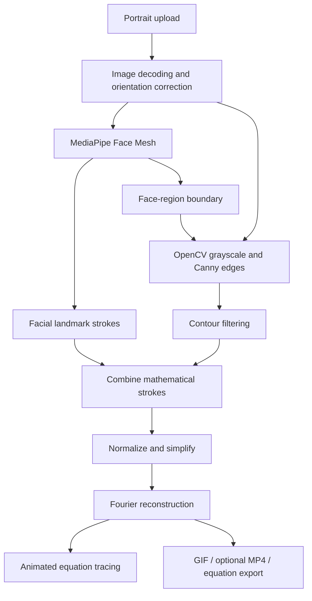

# Mathematical Face Sketch

<p align="center">
  <strong>Turn a portrait into a mathematical drawing, one parametric curve at a time.</strong><br/>
  MediaPipe facial landmarks + OpenCV contours + Fourier reconstruction + live equation tracing.
</p>

<p align="center">
  
  
  
  
</p>

---

## Project preview

**Portrait → facial geometry → mathematical strokes → Fourier equations → animated portrait**

The application does not generate an AI replacement face. It extracts geometric features and reconstructs them as smooth mathematical curves, then animates the drawing process while displaying the equations.

> A demo GIF is not currently committed to this repository. The `assets/` directory is reserved for a genuine project recording; no placeholder image is presented as a working demo.

## Features

- Upload JPG, JPEG, PNG, or WEBP portraits.
- Correct image orientation using EXIF metadata.
- Detect facial landmarks with MediaPipe Face Mesh.
- Extract selected additional contours with OpenCV Canny edge detection.
- Build separate strokes for the face contour, eyebrows, eyes, lips, and nose.
- Smooth strokes with Fourier-based parametric reconstruction.
- Animate the drawing with a moving pointer and live equation panel.
- Replay the mathematical tracing.
- Export the animation as GIF.
- Attempt MP4 export when the local OpenCV codec is available.
- Export equations as text for exploration in Desmos.

## How the pipeline works



### 1. Facial geometry

MediaPipe Face Mesh provides landmark coordinates for the main facial structures. The current engine defines explicit landmark loops for the face contour, both eyebrows, both eyes, lips, and nose.

### 2. Additional image contours

OpenCV converts the image to grayscale, applies Gaussian blur and Canny edge detection, then filters contours by size and location. The face-region boundary constrains the additional contours to the detected face and nearby hair region.

### 3. Fourier reconstruction

Each stroke is normalized into a shared mathematical coordinate system. The engine applies a truncated Fourier representation to reconstruct a smooth parametric curve:

```text
x(t) = a₀ + Σ [aₖ cos(kt) + bₖ sin(kt)]
y(t) = c₀ + Σ [cₖ cos(kt) + dₖ sin(kt)]
0 ≤ t ≤ 2π
```

### 4. Animated construction

The interface traces one stroke at a time. It highlights the active equation, moves a pointer along the reconstructed curve, and leaves completed strokes visible.

## Project architecture

| File | Responsibility |
|---|---|
| `app.py` | Streamlit interface, image upload, animation component, and exports |
| `math_engine.py` | Face geometry, contour extraction, stroke processing, Fourier equations |
| `requirements.txt` | Compatible Python dependencies |
| `assets/` | Optional genuine screenshots and demo recordings |

## Installation

### Requirements

- Python 3.11 recommended
- Windows 10/11 or a compatible Python environment
- 64-bit Python
- MediaPipe 0.10.21 (the engine uses the `mp.solutions.face_mesh` API)

### 1. Clone

```bash
git clone https://github.com/Muhammad-Tayyab-official/Mathematical-Face-Sketch.git
cd Mathematical-Face-Sketch
```

### 2. Create and activate a virtual environment

**Windows PowerShell**
```powershell
python -m venv .venv
.\.venv\Scripts\Activate.ps1
```

**macOS / Linux**
```bash
python3 -m venv .venv
source .venv/bin/activate
```

### 3. Install dependencies

```bash
python -m pip install --upgrade pip
pip install -r requirements.txt
```

The dependency file constrains MediaPipe to `0.10.21`, NumPy to the 1.x series, and Protobuf to 4.x for compatibility with the current Face Mesh API.

### 4. Run

```bash
streamlit run app.py
```

Open the local Streamlit URL shown in the terminal.

## Usage tips

- Use a clear portrait with one visible, mostly front-facing face.
- Good lighting and limited obstruction generally help landmark detection.
- If no face is detected, try a sharper image with the face facing the camera.
- MP4 export depends on codec support in the installed OpenCV build; GIF export is provided separately.

## Technology stack

- **Python** — application and mathematical processing
- **Streamlit** — interactive web interface
- **MediaPipe Face Mesh** — facial landmarks
- **OpenCV** — image processing and contour extraction
- **NumPy** — numerical operations and Fourier transforms
- **Pillow** — image handling and GIF export

## Limitations

- Results depend on face visibility, pose, lighting, and image quality.
- Canny contours may include visual details that are not facial features.
- Fourier smoothing approximates each stroke; it is not a semantic 3D face model.
- MP4 availability varies by platform and codec installation.
- The repository currently has no committed sample portrait or verified demo recording.

## License

This project is distributed under the MIT License. See [LICENSE](LICENSE).

## Author

**Muhammad Tayyab** — Mathematics with Data Science Student

- GitHub: [@Muhammad-Tayyab-official](https://github.com/Muhammad-Tayyab-official)
- LinkedIn: [Tayyab Younas](https://www.linkedin.com/in/tayyab-younas-05b068389/)
- Portfolio: [my-portfolio](https://my-portfolio-chi-amber-40.vercel.app/)
